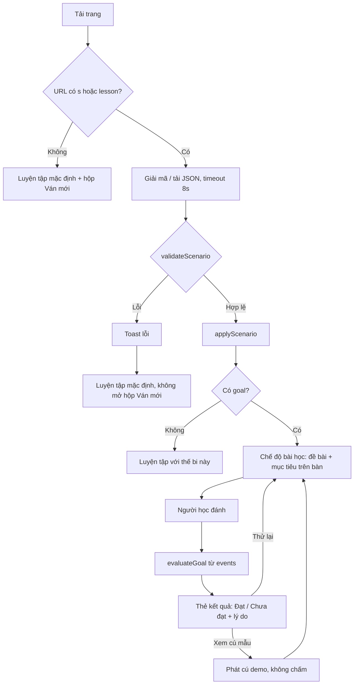

# T-001: Định dạng thế bi (scenario) + chế độ bài học nhúng được

| Status | Quy mô | Ngày tạo | Cập nhật | Liên quan |
|---|---|---|---|---|
| Done | M | 2026-11-19 | 2026-11-19 | — |

> ID truy vết: yêu cầu `T-001.R1`, business rule `T-001.BR1`, tiêu chí `T-001.AC1`.

## 1. Nghiệp vụ

### 1.1 Bối cảnh & mục tiêu
- **Vấn đề:** Bida 3D Pro đã có vật lý và công cụ luyện tập, nhưng một thế bi chỉ tồn tại trong bộ nhớ của trang. Không lưu, không nạp, không chia sẻ được (chỉ có tham số `?nomenu`). Vì vậy chưa thể soạn bài học, chưa nhúng được vào trang nội dung, chưa chấm được bài tập.
- **Ai được lợi:** người soạn bài (chủ dự án) soạn bài bằng file dữ liệu thay vì sửa code; người học có bài tập có đề, có chấm, có cú mẫu.
- **Thành công khi:** thêm một bài học mới chỉ cần thêm 1 file JSON; mở link bài học là thấy đúng thế bi và được chấm sau khi đánh; 3 bài mẫu đi kèm đều giải được bằng chính cú mẫu của chúng (có test tự động).

Đây là bước nền cho web học bida (trang thuật ngữ, bài học, clip 3D). Các bước đó nằm ngoài task này.

### 1.2 Phạm vi
| In scope | Out of scope |
|---|---|
| Định dạng scenario v1 (JSON) + kiểm tra hợp lệ | Trang nội dung tĩnh, SEO, từ điển thuật ngữ |
| Nạp scenario qua `?s=` (link tự chứa) và `?lesson=<id>` (file trong `lessons/`) | Tài khoản, thanh toán, khóa bài nâng cao |
| Chế độ bài học: đề bài, mục tiêu vẽ trên bàn, chấm đạt/chưa đạt, cú mẫu, thử lại | Lưu tiến độ người học |
| Nút "Chia sẻ thế bi" ở chế độ luyện tập | Xuất video/clip từ cú đánh |
| 3 bài mẫu + test | Luật chơi mới (bài lá, đánh đền), carom, masse |
| `npm test` chạy đủ mọi file test | Tách nhỏ `js/main.js` |

### 1.3 Yêu cầu / User stories
| ID | Là (actor) | Tôi muốn | Để |
|---|---|---|---|
| T-001.R1 | Người soạn bài | mô tả thế bi, cú đánh khởi đầu, cú mẫu và mục tiêu trong 1 file JSON | thêm bài học mà không sửa code |
| T-001.R2 | Người học | mở link bài học và thấy đúng thế bi, đề bài, mục tiêu được đánh dấu trên bàn | biết ngay phải làm gì |
| T-001.R3 | Người học | tự đánh rồi được báo đạt/chưa đạt kèm lý do từng điều kiện | biết mình sai ở đâu |
| T-001.R4 | Người học | xem cú mẫu rồi thử lại | học cách đánh đúng |
| T-001.R5 | Người luyện tập | lấy link của thế bi đang bày trên bàn | chia sẻ, hoặc dùng làm nháp cho bài học |
| T-001.R6 | Chủ site | đặt bài học vào trang khác bằng `<iframe>` | minh họa bài viết bằng bàn bida thật |
| T-001.R7 | Lập trình viên | `npm test` chạy mọi file test như CI | không sót lỗi khi chạy local |

### 1.4 Business rules
- **T-001.BR1:** Scenario chỉ được nạp khi hợp lệ: có bi cái (id 0); id bi thuộc 0–15, không trùng; mọi bi nằm trong lòng bàn; không bi nào chồng nhau. Scenario không hợp lệ bị từ chối, báo lỗi cho người dùng và trang trở về thế luyện tập mặc định.
- **T-001.BR2:** Trong chế độ bài học, người học không được dời, thêm hay nhặt bi. Mức trợ giúp đường bi do bài quy định (`lines`), người học không tự bật cao hơn.
- **T-001.BR3:** Bài được chấm bằng diễn biến của cú đánh thật (sự kiện va chạm, rơi lỗ và vị trí bi khi dừng), không dùng đường dự đoán. Đạt khi mọi điều kiện của `goal` cùng thỏa.
- **T-001.BR4:** Cú mẫu không được tính là kết quả của người học.
- **T-001.BR5:** Chữ lấy từ scenario (tiêu đề, đề bài) luôn hiển thị dạng văn bản thuần, có giới hạn độ dài (tiêu đề 80, đề bài 400 ký tự). Tham số `?s=` dài quá 4 KB bị từ chối.
- **T-001.BR6:** `?lesson=<id>` chỉ nhận id khớp `[a-z0-9-]{1,64}` và chỉ tải từ thư mục `lessons/` cùng origin.

## 2. Acceptance criteria
| ID | Yêu cầu | Given | When | Then |
|---|---|---|---|---|
| T-001.AC1 | R1, BR1 | Một object scenario hợp lệ | gọi `validateScenario` | trả về scenario đã chuẩn hóa; `encode` rồi `decode` cho lại đúng dữ liệu (kể cả tiếng Việt có dấu) |
| T-001.AC2 | BR1, BR5 | Scenario thiếu bi cái / bi chồng nhau / bi ngoài bàn / id trùng / payload > 4 KB | gọi `validateScenario` hoặc `decodeScenario` | ném lỗi có thông điệp nêu rõ lý do |
| T-001.AC3 | R2, R6 | Trang mở với `?lesson=cat-30` | tải xong | bàn có đúng các bi của bài, hiện thẻ đề bài, lỗ mục tiêu được đánh dấu, không hiện hộp "Ván mới", nhóm "Luyện tập · Xếp bi" bị ẩn |
| T-001.AC4 | BR2 | Đang ở chế độ bài học | kéo vào một bi trên bàn | bi không di chuyển |
| T-001.AC5 | R3, BR3 | Đang ở bài `cat-30` | đánh cú đưa bi 1 vào đúng lỗ, bi cái không rơi lỗ | thẻ kết quả báo "Đạt" và liệt kê từng điều kiện đã thỏa |
| T-001.AC6 | R3, BR3 | Đang ở bài `cat-30` | đánh trượt hoặc bi cái rơi lỗ | thẻ kết quả báo "Chưa đạt" và chỉ ra điều kiện nào không thỏa |
| T-001.AC7 | R4, BR4 | Vừa đánh xong một cú | bấm "Xem cú mẫu" | bàn về thế ban đầu, cú mẫu được đánh, kết quả ghi nhãn "Cú mẫu" kèm thông số cú mẫu; bấm "Thử lại" thì bàn về thế ban đầu với thiết lập cú đánh của người học được giữ lại |
| T-001.AC8 | R4 | Vừa có kết quả "Chưa đạt" | bấm "Thử lại" | bàn về thế ban đầu, hướng cơ / lực / điểm chạm của người học được giữ nguyên |
| T-001.AC9 | R5 | Chế độ luyện tập, đã tự bày bi | bấm "Chia sẻ thế bi" rồi mở link vừa copy | trang mở đúng vị trí bi và thiết lập cú đánh đó, ở chế độ luyện tập; "Đặt lại" trả về đúng thế bi này |
| T-001.AC10 | BR1, BR6 | `?lesson=khong-co` hoặc `?lesson=../x` hoặc `?s=rác` | tải trang | có thông báo lỗi, trang vào thế luyện tập mặc định, console không có lỗi chưa bắt |
| T-001.AC11 | R1 | 3 file trong `lessons/` | chạy test | mỗi file hợp lệ và cú mẫu (`demo`) của nó thỏa `goal` của chính nó |
| T-001.AC12 | R7 | Repo sau thay đổi | `npm test` | chạy toàn bộ `tests/*.test.js`, tất cả pass (43 test cũ + test mới) |
| T-001.AC14 | R2, R6 | Bài học mở trong `<iframe>` 720×520 và trên màn 375×812 | tải xong | thấy trọn bàn, kể cả lỗ mục tiêu; có nút "Bắn" ngay trên thẻ bài học |
| T-001.AC13 | R2, R6 | Bài học ở khung 1440×900 và 375×812 | xem trang | thẻ đề bài và kết quả không che bàn, không tràn ngang, console không lỗi |

## 3. Thiết kế

### 3.1 Impact analysis
| Khu vực | File / module | Ảnh hưởng |
|---|---|---|
| Định dạng dữ liệu (mới) | `js/scenario.js` | Mới. Thuần, không DOM: `validateScenario`, `encodeScenario`, `decodeScenario`, `scenarioFromState`, `shotSpeed` |
| Chấm bài (mới) | `js/lesson.js` | Mới. Thuần: `evaluateGoal(goal, events, balls)` trả `{ pass, checks[] }` |
| Vòng đời trang | `js/main.js` | Thêm `applyScenario`, khởi động theo URL, nhánh chấm bài trong `finishShot`, khóa công cụ bi khi ở bài học, vẽ mục tiêu, nối các nút mới. `powerToSpeed` chuyển sang gọi `shotSpeed` |
| Giao diện | `index.html`, `css/style.css` | Thẻ bài học (đề bài, kết quả, 2 nút), nút "Chia sẻ thế bi", class `body.lesson` |
| Nội dung | `lessons/thang-co-ban.json`, `lessons/cat-30.json`, `lessons/dung-bi.json` | Mới. 3 bài mẫu |
| Test | `tests/scenario.test.js`, `tests/lesson.test.js` | Mới |
| Build / deploy | `Dockerfile`, `nginx.conf`, `package.json` | Copy `lessons/` vào image; `.json` dùng `no-cache` như js/css; `npm test` chạy `tests/*.test.js` |

Không đụng: `js/physics.js`, `js/aim.js`, `js/rules.js`, `js/racks.js`, chế độ ván 2 người.

### 3.2 Giải pháp

**Hai đường nạp, một định dạng.** `?s=` mang cả scenario trong link (base64url của JSON), không cần backend, dùng cho chia sẻ. `?lesson=<id>` tải `lessons/<id>.json`, dùng cho bài học do mình soạn: link ngắn, sửa bài không đổi link. Cả hai đi qua cùng `validateScenario` rồi `applyScenario`.

**Chế độ bài học bật khi scenario có `goal`.** Scenario không có `goal` (ví dụ link chia sẻ) mở ở chế độ luyện tập bình thường, chỉ khác là bàn bắt đầu bằng thế bi đó.

**Chấm bài tách khỏi giao diện.** Vật lý tất định và `stepWorld` đã ghi sự kiện, nên `evaluateGoal` chỉ cần đọc `state.events` và vị trí bi khi dừng. Nhờ thuần nên test được bằng `simulate()` trong Node, và test AC11 bảo đảm bài mẫu nào cũng giải được.

**Cú mẫu là phát lại, không phải video.** Đặt bàn về thế ban đầu, gán `state.shot = demo`, gọi lại đúng `shoot()` hiện có với cờ `demo`. Không thêm hệ thống replay riêng.



### 3.4 Data contract: scenario v1

```json
{
  "v": 1,
  "id": "cat-30",
  "title": "Cắt 30° vào lỗ góc",
  "prompt": "Đưa bi 1 vào lỗ góc trên-phải. Chỉ chỉnh hướng cơ, đánh giữa bi.",
  "balls": [
    { "id": 0, "x": -0.05, "y": -0.31 },
    { "id": 1, "x": 0.55, "y": -0.05 }
  ],
  "shot": { "angle": 20, "power": 35, "a": 0, "b": 0, "elev": 0 },
  "demo": { "angle": 31.4, "power": 40, "a": 0, "b": 0, "elev": 0 },
  "goal": {
    "pot": [{ "ball": 1, "pocket": 3 }],
    "noScratch": true,
    "firstContact": 1,
    "cueZone": { "x": 0.2, "y": 0.1, "r": 0.2 }
  },
  "lines": "aim",
  "view": "persp"
}
```

| Trường | Bắt buộc | Ý nghĩa |
|---|---|---|
| `v` | Có | Phiên bản định dạng. Khác 1 thì từ chối |
| `balls[]` | Có | Vị trí bi theo mét, gốc ở tâm bàn: `x` dọc bàn (±1.27), `y` ngang bàn (±0.635). Phải có id 0 |
| `shot` | Không | Thiết lập cú đánh lúc mở bài. `angle`, `elev` tính bằng độ; `power` 1–100; `a`, `b` là điểm chạm đầu cơ theo bán kính bi (giới hạn 0.5); `elev > 0` nghĩa là gậy nhảy |
| `demo` | Không | Cú mẫu, cùng cấu trúc với `shot`. Thiếu thì ẩn nút "Xem cú mẫu" |
| `goal` | Không | Có thì bật chế độ bài học |
| `goal.pot[]` | Không | Bi phải vào lỗ; `pocket` (0–5) bỏ trống nghĩa là lỗ nào cũng được |
| `goal.noScratch` | Không | Mặc định `true`: bi cái rơi lỗ hoặc bay khỏi bàn là trượt |
| `goal.firstContact` | Không | Bi cái phải chạm bi này trước tiên |
| `goal.cueZone` | Không | Bi cái phải dừng trong vòng tròn này (bài điều bi) |
| `lines` | Không | `off` / `aim` / `full`, mặc định `aim` |
| `id`, `title`, `prompt`, `view` | Không | Hiển thị và góc nhìn ban đầu |

Mã hóa `?s=`: `JSON.stringify` → UTF-8 → base64url.

### 3.5 Edge cases & rủi ro
- **Bi nhảy khỏi bàn / bi cái rơi lỗ ở chế độ bài học:** hiện tại `finishShot` tự đặt lại bi cái. Ở bài học phải chấm trước, rồi mới về thế ban đầu khi bấm "Thử lại".
- **Cú đánh không dừng:** `runSimulation` đã có điểm dừng khi mọi bi đứng yên; chấm bài chỉ chạy sau điểm đó, không thêm vòng chờ mới.
- **`cueZone` nằm sát băng hoặc trùng vị trí bi khác:** `validateScenario` chỉ kiểm tra tâm vùng nằm trong bàn; tính hợp lý của bài do test AC11 bắt (cú mẫu phải đạt).
- **Link `?s=` do người lạ tạo:** nội dung là dữ liệu không tin cậy. Chữ chỉ gán qua `textContent`, số bị kẹp về khoảng hợp lệ, payload có trần 4 KB.
- **Tải `lessons/<id>.json` lỗi mạng, 404, JSON hỏng:** `fetch` có `AbortController` 8 giây, bắt lỗi, báo toast và về luyện tập mặc định.
- **`try_files $uri /index.html` trong nginx:** file bài học không tồn tại sẽ trả về `index.html` với mã 200. Vì vậy phải kiểm tra `Content-Type`/parse JSON thất bại như một lỗi "không có bài", không coi là thành công.
- **Clipboard bị chặn** (http không phải localhost, hoặc trong iframe): rơi về hiển thị link trong hộp thoại để người dùng tự copy.
- **Thay đổi `powerToSpeed` về sau** sẽ làm lệch cú mẫu của các bài đã soạn. Test AC11 sẽ đỏ, đó là tín hiệu phải chỉnh lại bài.
- **Hồi quy chế độ cũ:** luyện tập không tham số URL và ván 2 người phải chạy y như trước; 43 test hiện có phải vẫn pass.
- **Deploy:** push lên `main` tự deploy lên Azure VM. Mọi thay đổi nằm trên nhánh `feat/scenario-lesson-mode`, không commit/push khi chưa được yêu cầu.

## 4. Thay đổi thực tế
| File | Thay đổi | Yêu cầu |
|---|---|---|
| `js/scenario.js` (mới) | `validateScenario`, `encodeScenario`, `decodeScenario`, `scenarioFromState`, `shotToState`, `shotSpeed`; hằng `TIP_LIMIT`, `LESSON_ID`, `MAX_ENCODED` | R1, R5, BR1, BR5, BR6 |
| `js/lesson.js` (mới) | `evaluateGoal` trả `{ pass, checks[] }`; `POCKET_NAMES` chuyển về đây | R3, BR3 |
| `js/main.js` | `applyScenario` / `leaveScenario`, khởi động theo `?s=` và `?lesson=`, nhánh chấm bài trong `finishShot`, `retryLesson`, `playDemo`, `shareTable`, `fetchLesson` (timeout 8 giây), vẽ mục tiêu trên bàn, khóa sửa bi khi ở bài học, `powerToSpeed` gọi `shotSpeed` | R2–R6, BR2, BR4 |
| `js/main.js` (bố cục) | Ở bài học, bàn tránh cột thẻ bên trái khi cửa sổ đủ rộng; giới hạn zoom-out nới theo kích thước màn hình **chỉ khi đang ở bài học** | R2, R6 |
| `index.html` | Thẻ `#lesson` (đề bài, kết quả, nút Bắn / Thử lại / Xem cú mẫu), nút "Chia sẻ thế bi", hộp `#shareBox`, id `linesGroup`, `pocketAim` | R2–R5 |
| `css/style.css` | Khối "v4: lessons" | R2, R6 |
| `lessons/thang-co-ban.json`, `lessons/cat-30.json`, `lessons/dung-bi.json` (mới) | 3 bài mẫu, vị trí và cú mẫu tính bằng chính engine | R1 |
| `tests/scenario.test.js`, `tests/lesson.test.js` (mới) | 17 test | R1, R3, R7 |
| `package.json` | `npm test` chạy `tests/*.test.js` | R7 |
| `Dockerfile`, `nginx.conf` | Copy `lessons/` vào image; `.json` dùng `no-cache` | R1 |
| `.github/workflows/deploy_vm.yml` | Thêm `lessons` vào danh sách file copy lên VM. **Ngoài bảng 3.1**: thiếu nó thì `COPY lessons` trong Dockerfile làm hỏng build khi deploy | R1 |

Phát sinh so với plan đã duyệt:
- Thêm nút "Bắn" ngay trên thẻ bài học, vì trên mobile và trong iframe bảng điều khiển bị thu gọn nên không có cách nào bắn.
- Ở bài học ẩn nhóm "Ngắm bi mục tiêu vào lỗ" (nút tự ngắm sẽ giải luôn bài đưa bi vào lỗ) và nhóm "Đường bi" (theo BR2).
- Kết quả cú mẫu hiện thêm một dòng thông số (hướng cơ, lực, điểm chạm) để người học đối chiếu.
- Nới giới hạn zoom-out khi ở bài học: trên màn dọc 375 px bàn bị tràn ngang, lỗ mục tiêu nằm ngoài màn hình. Lỗi này có sẵn ở mọi chế độ (camera bị chặn ở 6 m); chỉ sửa cho bài học, chế độ luyện tập và ván đấu giữ nguyên.

## 5. Verification
| AC | Cách kiểm | Kết quả | Bằng chứng |
|---|---|---|---|
| T-001.AC1 | `tests/scenario.test.js` | PASS | "a valid scenario is normalised", "encode -> decode round-trips, Vietnamese text included", rack 15 bi round-trip |
| T-001.AC2 | `tests/scenario.test.js` | PASS | "invalid tables are rejected with a reason" (12 trường hợp), "garbage and oversized share payloads are rejected" |
| T-001.AC3 | Trình duyệt, `?lesson=cat-30`, 1440×900 | PASS | bi 0 tại (0.626, −0.269), bi 1 tại (0.8, 0.2); thẻ đề bài hiện; `menu.open = false`; `practiceGroup.hidden = true`; vòng vàng ở lỗ góc trên-phải |
| T-001.AC4 | Trình duyệt: ép `state.tool = 'move'` rồi kéo chuột thật từ bi 1 | PASS | bi 1 vẫn ở (0.8, 0.2); thao tác kéo chỉ đổi hướng cơ |
| T-001.AC5 | Trình duyệt: hướng 73.09°, lực 35 rồi bấm "Bắn" | PASS | "Đạt"; ✓ Bi 1 vào lỗ góc trên-phải, ✓ Bi cái chạm bi 1 trước, ✓ Bi cái không rơi lỗ |
| T-001.AC6 | Trình duyệt: hướng 71°, lực 50 | PASS | "Chưa đạt"; ✗ Bi 1 chưa vào lỗ góc trên-phải. Bài `dung-bi` với cú khởi đầu: ✗ Bi cái dừng cách vùng mục tiêu 14 cm |
| T-001.AC7 | Trình duyệt: bấm "Xem cú mẫu" rồi "Thử lại" | PASS | nhãn "Cú mẫu", dòng "Hướng cơ 73.09° · Lực 35% · Điểm chạm: giữa bi"; sau "Thử lại" cú đánh về lại 71° / 50 của người học |
| T-001.AC8 | Trình duyệt: "Thử lại" sau cú trượt | PASS | bi về vị trí ban đầu, cú đánh giữ 71° / 50 |
| T-001.AC9 | Trình duyệt: rack 9 bi, dời bi cái, đổi cú đánh, "Chia sẻ", mở link | PASS | 10 bi khớp tới 5 chữ số thập phân; cú đánh −8.5° / 77 / a 0.2 / b −0.3; `lesson = null`; "Đặt lại" trả về đúng thế bi này. Link dài 575 ký tự |
| T-001.AC10 | Trình duyệt: `?lesson=khong-co`, `?lesson=../x`, `?s=rác`, file bài học chứa HTML (giả lập nginx trả `index.html` 200), `?s=` hợp lệ nhưng thiếu bi cái | PASS | toast lần lượt: "Không tìm thấy bài học", "Mã bài học không hợp lệ" (không có request nào tới `lessons/`), "Link thế bi không hợp lệ", "Không tìm thấy bài học", "Thế bi thiếu bi cái"; cả 5 đều về preset `cut30`. Console chỉ có dòng 404 của trình duyệt cho file không tồn tại |
| T-001.AC11 | `tests/lesson.test.js` | PASS | 3 test "lesson <file>: valid, demo passes, starting shot does not" |
| T-001.AC12 | `npm test` | PASS | `# tests 60  # pass 60  # fail 0` (43 cũ + 17 mới) |
| T-001.AC13 | Screenshot 1440×900 và 375×812 | PASS | Desktop: cột thẻ kết thúc ở x = 316, mép trái bàn ở x ≥ 403. Mobile: thẻ cao tới y = 282 (có kết quả), mép trên bàn ở y = 492; `scrollWidth = 375`; nút cao 44 px |
| T-001.AC14 | Trình duyệt: iframe 720×520 và màn 375×812 | PASS | iframe: 4 góc bàn nằm trong 72–644 px trên bề rộng 716; mobile: 41–334 px trên 375 (trước khi sửa là −53 đến 428) |

Hồi quy chế độ cũ (trình duyệt): tải trang không tham số vẫn mở hộp "Ván mới"; luyện tập `cut30` bắn xong về lại pha ngắm, "Hoàn tác" khôi phục đúng vị trí; ván 9-ball bắt đầu và chuyển lượt sau cú phá; thoát bài học qua "Ván mới" trả lại đủ các nhóm điều khiển và giới hạn zoom 6 m.

Lệnh đã chạy: `npm test` (60/60 pass), `node --check js/main.js`. Dự án không có typecheck/lint/build.

Chưa kiểm được:
- Nhánh copy thành công của "Chia sẻ thế bi": trình duyệt kiểm thử chặn clipboard nên chỉ nhánh dự phòng (hộp hiện link) được chạy thật.
- Build Docker và nginx thật: chưa chạy `docker build`; hành vi "file thiếu trả `index.html` 200" mới chỉ được giả lập bằng một file bài học chứa HTML.

## 6. Quyết định & câu hỏi mở
- **Đã quyết:**
  - Một định dạng, hai đường nạp (`?s=` và `?lesson=`), không cần backend.
  - Chế độ bài học bật theo sự có mặt của `goal`, không thêm tham số `mode`.
  - Cú mẫu dùng lại `shoot()` hiện có, không xây hệ thống replay.
  - Không tách `js/main.js` trong task này.
- **Còn mở (đề xuất mặc định trong ngoặc, sẽ làm theo nếu không có ý kiến khác):**
  1. Sau khi trượt, "Thử lại" giữ thiết lập cú đánh của người học hay về thiết lập ban đầu của bài? (giữ, để chỉnh dần)
  2. Ba bài mẫu là: đánh thẳng, cắt 30°, dừng bi tại chỗ (stun). Có muốn đổi bài nào không? (giữ 3 bài này)
  3. Có giới hạn số lần xem cú mẫu không? (không giới hạn; để dành cho task thu phí sau này)

  Cả 3 đã làm theo đề xuất mặc định khi plan được duyệt ngày 2026-11-19.
- **Mở thêm sau khi thực thi:** chế độ luyện tập và ván đấu trên màn dọc hẹp vẫn bị tràn bàn (camera chặn ở 6 m). Có muốn áp cách sửa của bài học cho mọi chế độ không?

## 7. Ghi chú cho lần sau
- **Đường ngắm làm lộ đáp án.** Mức `lines: "aim"` vẽ luôn đường đi của bi mục tiêu và vòng xanh ở lỗ khi bi sẽ vào. Bài dùng mức này là bài có hướng dẫn. Bài kiểm tra thật phải đặt `lines: "off"`.
- **Cửa sổ góc ngắm hẹp.** Ba bài mẫu được chọn để có biên khoảng ±0.3° đến ±0.4° quanh góc mẫu. Thế bi `cutShot(…, 30, 0.6)` mặc định của app chỉ có biên ±0.05°, quá khó cho bài cơ bản. Khi soạn bài mới nên quét biên góc trước (xem cách làm trong `tests/lesson.test.js`).
- **`power` trong scenario là đơn vị thanh trượt (1–100)**, đổi sang m/s qua `shotSpeed`. Sửa công thức đó sẽ làm lệch mọi cú mẫu; test AC11 sẽ báo.
- **Bề rộng 761–1283 px ở bài học:** cột thẻ bên trái vẫn đè lên góc bàn (hằng `MIN_TABLE_W` trong `js/main.js`), giống thẻ phân tích ở chế độ luyện tập từ trước.
- **Thêm thư mục tĩnh mới phải sửa 2 chỗ:** `Dockerfile` và danh sách `source` trong `.github/workflows/deploy_vm.yml`.
- **Chưa có danh mục bài học** (`lessons/index.json`) và chưa lưu tiến độ; để cho task trang nội dung.
- Dòng gợi ý phím ở đáy màn hình vẫn nhắc "L: đường bi" khi ở bài học, dù phím này đã bị khóa.
