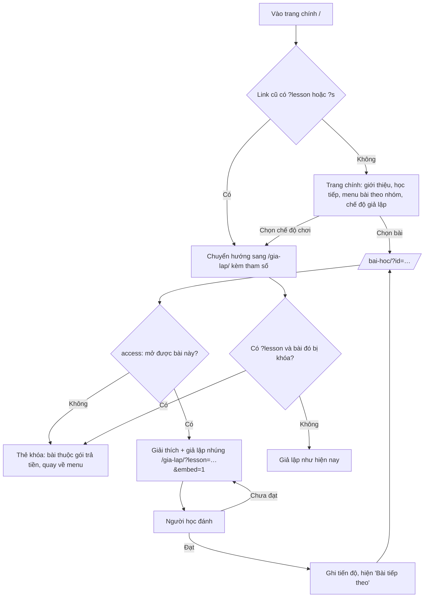

# T-006: Trang chính có menu đầy đủ, tách giả lập sang route riêng, dựng sẵn khung thu phí

| Status | Quy mô | Ngày tạo | Cập nhật | Liên quan |
|---|---|---|---|---|
| Done | L | 2026-11-19 | 2026-11-19 | T-001, T-005, [ADR-0002](../adr/ADR-0002-cau-truc-trang-va-diem-noi-thu-phi.md) |

> Đánh dấu `[L]` = mục chỉ bắt buộc với task L.
> ID truy vết: yêu cầu `T-006.R1`, business rule `T-006.BR1`, tiêu chí `T-006.AC1`.

## 1. Nghiệp vụ

### 1.1 Bối cảnh & mục tiêu
- **Vấn đề:** cả sản phẩm hiện là một màn hình giả lập. Người mới vào gặp ngay bảng điều khiển 3D, không biết có 10 bài học, và chỉ mở được bài nếu biết sẵn link `?lesson=…`. Không có chỗ nào để sau này chia bài miễn phí / trả tiền, tính tiền hay khóa tính năng.
- **Ai được lợi:** người học (thấy toàn bộ nội dung, chọn bài, biết mình đã học tới đâu) và chủ dự án (có khung để gắn thu phí mà không phải làm lại giao diện).
- **Thành công khi:** vào trang chính thấy đủ mọi bài và mọi chế độ chơi; mỗi bài có trang riêng; giả lập chạy ở route riêng; việc "bài này có mở được không" và "tính năng này có dùng được không" chỉ được quyết định ở một chỗ trong mã.

### 1.2 Phạm vi
| In scope | Out of scope |
|---|---|
| Trang chính mới: giới thiệu ngắn, menu đủ 10 bài theo nhóm, các chế độ giả lập, "học tiếp" | Tài khoản, đăng nhập |
| Trang bài học: giải thích, giả lập nhúng, bài trước / bài sau | Thanh toán, trang bảng giá |
| Giả lập chuyển sang `/gia-lap/`; link cũ `/?lesson=`, `/?s=` tự chuyển hướng | Khóa thật ở phía máy chủ (xem BR4) |
| Tiến độ học lưu trên máy người dùng | Trang thuật ngữ, SEO, trang tĩnh riêng cho từng bài |
| Điểm nối thu phí: hạng bài (`tier`), một module quyết định quyền mở bài và quyền dùng tính năng, giao diện trạng thái khóa | Quyết định bài nào trả tiền, tính năng nào bị khóa, giá |
| Hệ token thiết kế dùng chung cho trang và giả lập | Thiết kế lại bảng điều khiển của giả lập |
| nginx, Dockerfile, workflow deploy cho cấu trúc nhiều trang | Đổi tech stack (vẫn HTML/CSS/ES module tĩnh, không build) |

### 1.3 Yêu cầu / User stories
| ID | Là (actor) | Tôi muốn | Để |
|---|---|---|---|
| T-006.R1 | Người mới vào | thấy ngay trang giới thiệu và danh sách mọi bài học theo nhóm | biết sản phẩm có gì và bắt đầu từ đâu |
| T-006.R2 | Người học | mở một bài và đọc phần giải thích ngay cạnh bàn tập | hiểu mình đang tập cái gì trước khi đánh |
| T-006.R3 | Người học | thấy bài nào đã đạt và được gợi ý bài tiếp theo | học theo lộ trình, quay lại là học tiếp |
| T-006.R4 | Người chơi | vào thẳng giả lập (luyện tập tự do, ván 2 người) từ trang chính | chơi mà không phải đi qua bài học |
| T-006.R5 | Người có link cũ | link `/?lesson=…` và `/?s=…` vẫn mở đúng | link đã chia sẻ không chết |
| T-006.R6 | Chủ dự án | đánh dấu một bài là trả tiền bằng dữ liệu, không sửa giao diện | chia bài miễn phí / trả tiền khi sẵn sàng |
| T-006.R7 | Chủ dự án | có một chỗ duy nhất trong mã quyết định quyền mở bài và quyền dùng tính năng | sau này nối với tài khoản và thanh toán mà không lần khắp nơi |
| T-006.R8 | Người dùng điện thoại | dùng được mọi trang ở 375 px | học trên điện thoại |

### 1.4 Business rules
- **T-006.BR1:** Hiện tại mọi bài đều `free`, mọi tính năng đều mở. Task này chỉ dựng khung, không khóa gì của người dùng.
- **T-006.BR2:** Bài `pro` mà người dùng chưa có quyền thì hiện trạng thái khóa (ở menu, ở trang bài, và khi vào thẳng giả lập bằng link). Không tải thế bi của bài đó.
- **T-006.BR3:** Tiến độ chỉ ghi "đạt" khi chính người học đánh đạt; xem cú mẫu không tính.
- **T-006.BR4:** Trên một trang tĩnh, khóa chỉ là giao diện: file bài vẫn tải được nếu biết đường dẫn. Khóa thật cần máy chủ kiểm quyền rồi mới trả nội dung. Tài liệu và mã phải ghi rõ điều này, không tạo cảm giác đã bảo vệ.
- **T-006.BR5:** Chữ tiếng Việt giữ đủ dấu. Không thêm thư viện hay font tải từ bên ngoài.
- **T-006.BR6:** Mọi thứ đang chạy ở giả lập (luyện tập, ván 2 người, bài học, chia sẻ thế bi) giữ nguyên hành vi.

### 1.5 Luồng người dùng `[L]`


## 2. Acceptance criteria
| ID | Yêu cầu | Given | When | Then |
|---|---|---|---|---|
| T-006.AC1 | R1 | Mở `/` | trang tải xong | thấy đủ 10 bài chia 5 nhóm, mỗi bài có tên và một dòng mô tả; có lối vào giả lập |
| T-006.AC2 | R1 | `lessons/index.json` tải chậm hoặc lỗi | mở `/` | lúc chờ có khung xương; lỗi thì có thông báo và nút "Thử lại"; phần giới thiệu và lối vào giả lập vẫn dùng được |
| T-006.AC3 | R2 | Bấm một bài ở trang chính | trang bài mở | có tên bài, nhóm, phần giải thích, giả lập nhúng đúng bài đó, nút bài trước / bài sau |
| T-006.AC4 | R2 | `/bai-hoc/?id=khong-co` hoặc thiếu `id` | mở | thông báo không tìm thấy bài và link về menu; không lỗi JS |
| T-006.AC5 | R3, BR3 | Trang bài đang mở | người học đánh đạt | trang hiện "Đã đạt" và nút "Bài tiếp theo" mà không cần tải lại; về trang chính thấy bài có dấu đã đạt |
| T-006.AC6 | BR3 | Trang bài đang mở | chỉ xem cú mẫu | bài không bị ghi là đã đạt |
| T-006.AC7 | R3 | Đã đạt ít nhất một bài | mở `/` | khối "Học tiếp" trỏ tới bài đầu tiên chưa đạt theo thứ tự menu |
| T-006.AC8 | R4 | Ở trang chính | bấm "Mở giả lập" | vào `/gia-lap/`, giả lập chạy như bản hiện tại, có link quay về trang chính |
| T-006.AC9 | R5 | Link `/?lesson=cat-30` và một link `/?s=…` cũ | mở | chuyển sang `/gia-lap/` với đúng tham số và mở đúng bài / thế bi |
| T-006.AC10 | R6, BR2 | Một bài được đặt `tier: "pro"` trong dữ liệu thử, người dùng gói `free` | mở `/`, mở trang bài, mở `/gia-lap/?lesson=<bài đó>` | menu hiện khóa; trang bài hiện thẻ khóa, không có giả lập; giả lập báo bài bị khóa và không tải thế bi |
| T-006.AC11 | R7 | Mã nguồn | tìm nơi quyết định quyền | chỉ `js/site/access.js` chứa quy tắc; trang chính, trang bài và giả lập đều gọi nó. Có test cho `free` / `pro`, bài và tính năng |
| T-006.AC12 | BR1 | Dữ liệu thật trong repo | chạy test | mọi bài `free`; `canUseFeature` trả `true` cho mọi tính năng đã khai báo |
| T-006.AC13 | R8 | Trình duyệt 375×812 và 1440×900 | mở `/`, một trang bài, `/gia-lap/` | không tràn ngang; nút và link bấm được cao tối thiểu 44 px; console không lỗi |
| T-006.AC14 | R8 | Bàn phím | Tab qua trang chính và trang bài | thứ tự hợp lý, luôn thấy vòng focus; trang có `header`, `nav`, `main`, tiêu đề đúng cấp |
| T-006.AC15 | BR6 | `/gia-lap/` | luyện tập cắt 30°, ván 9 bi, một bài học, chia sẻ thế bi rồi mở link | chạy như trước; link chia sẻ mới trỏ về `/gia-lap/?s=…` |
| T-006.AC16 | BR6 | Repo sau thay đổi | `npm test` | 0 fail; 2 `todo` cũ không đổi |
| T-006.AC17 | — | Image Docker build từ repo | chạy và gọi `/`, `/gia-lap/`, `/gia-lap` (thiếu gạch chéo), `/bai-hoc/?id=cat-30`, `/lessons/index.json` | cả 5 trả đúng trang (thiếu gạch chéo thì chuyển hướng), có `Cache-Control: no-cache` |
| T-006.AC18 | BR5 | Trang chính và trang bài | xem tab mạng | không có request nào ra ngoài origin |

## 3. Thiết kế

### 3.1 Impact analysis
| Khu vực | File / module | Ảnh hưởng |
|---|---|---|
| Trang chính (mới) | `index.html`, `js/site/home.js` | `index.html` hiện tại (giả lập) được thay bằng trang chính |
| Giả lập | `gia-lap/index.html` | Là `index.html` cũ, dời vào đây; đường dẫn tài nguyên đổi sang tuyệt đối (`/css`, `/js`, `/vendor`) |
| Trang bài (mới) | `bai-hoc/index.html`, `js/site/lesson-page.js` | Đọc `?id=`, dựng phần giải thích, nhúng giả lập |
| Khung dùng chung (mới) | `js/site/catalog.js`, `js/site/access.js`, `js/site/progress.js`, `css/site.css`, `css/tokens.css` | Danh mục, quyền, tiến độ, giao diện trang; token dùng chung |
| Giả lập | `js/main.js`, `css/style.css` | Tải bài bằng đường dẫn tuyệt đối; chế độ `embed=1`; ghi tiến độ khi đạt; hỏi `access` trước khi mở bài; link về trang chính; link chia sẻ trỏ `/gia-lap/`; lấy màu từ `tokens.css` |
| Dữ liệu | `lessons/index.json` | Mỗi bài thêm `summary`, `intro`, `tier` |
| Hạ tầng | `nginx.conf`, `Dockerfile`, `.github/workflows/deploy_vm.yml` | Phục vụ thư mục có `index.html`; copy `gia-lap/`, `bai-hoc/` |
| Test | `tests/access.test.js`, `tests/progress.test.js`, `tests/lesson.test.js` | Mới cho quyền và tiến độ; test danh mục kiểm thêm trường mới |
| Tài liệu | `docs/adr/ADR-0002-cau-truc-trang-va-diem-noi-thu-phi.md` | Mới |

Không đụng: `js/physics.js`, `js/contact.js`, `js/aim.js`, `js/rules.js`, `js/racks.js`, `js/scenario.js`, `js/lesson.js`, các file bài học.

### 3.2 Giải pháp

**Hướng thiết kế.**
- **Ai dùng:** người chơi bida lỗ ở Việt Nam, từ mới tập tới trung bình, phần lớn trên điện thoại, tới từ tìm kiếm hoặc mạng xã hội. Việc của họ: chọn một kỹ năng, tập, biết mình đã qua bài nào.
- **Hình mẫu:** trang "Practice" của Lichess. Một danh mục bài tập theo chủ đề, dày thông tin, có dấu tiến độ, vào bài bằng một lần bấm, không có lớp quảng bá chen giữa.
- **Giọng điệu:** thực dụng và điềm tĩnh, như một cuốn sổ tập luyện ở quán bida.
- **Tránh:** hero chiếm cả màn hình với tiêu đề gradient; thẻ kính mờ; lưới thẻ giống hệt nhau mỗi thẻ một icon; emoji làm icon; hiệu ứng trang trí không mang thông tin.

**Token.** Lấy đúng bảng màu giả lập đang dùng (nền `#0e1116`, nhấn vàng `#f2c14e`, đạt `#6be3a0`, lỗi `#ff7a7a`), thêm màu nỉ `#0e5a3d` làm màu bề mặt phụ. Đưa vào `css/tokens.css`: màu, thang chữ, thang khoảng cách, bán kính, hai mức đổ bóng. `css/site.css` và `css/style.css` chỉ dùng token. Chữ dùng font hệ thống, phân cấp bằng cỡ, độ đậm và khoảng cách chữ (BR5).

**Bố cục trang chính.** Thanh trên: tên sản phẩm, "Bài học", "Giả lập". Khối mở đầu gọn: một câu nói sản phẩm làm gì, nút chính "Bắt đầu bài đầu tiên" (hoặc "Học tiếp: <tên bài>" nếu đã có tiến độ), nút phụ "Mở giả lập". Phần chính là menu bài: mỗi nhóm một tiêu đề và một danh sách dạng hàng (số thứ tự, tên, mô tả một dòng, trạng thái đã đạt / khóa), không phải lưới thẻ. Cuối trang: các chế độ giả lập (luyện tập tự do, ván 8/9/10 bi).

**Trang bài.** Trên: đường dẫn nhóm, tên bài, phần giải thích. Giữa: giả lập nhúng bằng `<iframe src="/gia-lap/?lesson=<id>&embed=1">`, cao theo màn hình. Dưới: trạng thái (chưa đạt / đã đạt), bài trước, bài sau. Bài bị khóa thì thay iframe bằng thẻ khóa.

**Ba điểm nối.**
- `js/site/access.js`: `getEntitlements()` hiện luôn trả `{ plan: 'free' }`; `canOpenLesson(lesson, ent)`; `canUseFeature(key, ent)` với bảng `FEATURES` khai báo các khóa (`match`, `share`, `fullLines`, `slowmo`, `breakPower`), hiện đều mở. Sau này chỉ thay `getEntitlements` bằng lời gọi máy chủ.
- `js/site/progress.js`: đọc / ghi `localStorage` khóa `bida.progress.v1`, bọc `try/catch`. Giả lập ghi khi người học đạt; trang bài nghe sự kiện `storage` để cập nhật ngay. Sau này thay phần lưu bằng tài khoản.
- `js/site/catalog.js`: tải và kiểm `lessons/index.json`, trả danh sách phẳng có thứ tự, bài trước / bài sau.

**Giả lập.** `embed=1` ẩn nút "Ván mới" và dòng gợi ý phím, giữ thẻ bài học và nút "Điều khiển". Khi không nhúng, thêm link "Trang chính" ở đầu bảng điều khiển.

**Hạ tầng.** `nginx.conf`: `try_files $uri $uri/ /index.html` và thêm `no-cache` cho trang trả qua thư mục. Trang chính có đoạn script đầu trang chuyển hướng link cũ trước khi vẽ gì.

### 3.3 Phương án đã cân nhắc `[L]`
| Phương án | Ưu | Nhược | Chọn? |
|---|---|---|---|
| A. Nhiều trang tĩnh, không build, điểm nối cho quyền và tiến độ | Giữ nguyên stack và cách deploy; làm nhanh; không thêm phụ thuộc | Trang bài dùng `?id=` nên yếu về SEO; khóa chỉ là giao diện | ✅ |
| B. Thêm bước build sinh trang tĩnh cho từng bài (`/bai-hoc/<id>/`) | SEO tốt hơn, mỗi bài một URL đẹp | Thêm bước build và đổi cách deploy; nên làm cùng lúc với trang thuật ngữ | Để sau |
| C. Chuyển sang framework (Next.js / Astro) + backend ngay | Có sẵn route, đăng nhập, API | Đổi stack lớn khi chưa có nội dung trả tiền; phải viết lại giả lập thành component | Không, cho tới khi làm thu phí |
| D. Một trang, đổi màn bằng hash (`#/bai-hoc/…`) | Không cần đổi nginx | Giả lập 3D phải tải ngay cả khi chỉ xem menu; không nhúng tách bạch được | Không |

### 3.4 Data model / hợp đồng `[L]`

`lessons/index.json`, mỗi bài:
```json
{
  "id": "tro-ve",
  "title": "Trô: kéo bi cái lùi về",
  "summary": "Hạ đầu cơ để bi cái lùi lại sau khi chạm bi mục tiêu.",
  "intro": "Trô là đánh vào dưới tâm bi cái để tạo xoáy ngược. … (2–4 câu giải thích ý nghĩa của yếu tố bài dạy)",
  "tier": "free"
}
```
- `title` phải trùng tiêu đề trong file bài (test hiện có).
- `tier`: `"free"` hoặc `"pro"`; thiếu thì coi là `"free"`.

Tiến độ trong `localStorage["bida.progress.v1"]`:
```json
{ "v": 1, "passed": { "tro-ve": "2026-11-19T15:30:00.000Z" } }
```

`access.js`:
```js
getEntitlements()            // -> { plan: 'free' | 'pro' }
canOpenLesson(lesson, ent)   // -> boolean
canUseFeature(key, ent)      // -> boolean, key thuộc FEATURES
```

URL:
| URL | Trang |
|---|---|
| `/` | Trang chính |
| `/bai-hoc/?id=<id>` | Trang bài |
| `/gia-lap/` | Giả lập; nhận `?lesson=`, `?s=`, `?nomenu`, `?embed=1` |
| `/?lesson=…`, `/?s=…` | Chuyển hướng sang `/gia-lap/` |

### 3.5 Edge cases & rủi ro
- **Khóa trên trang tĩnh không phải bảo vệ** (BR4). Ai biết đường dẫn `lessons/<id>.json` vẫn tải được. Chấp nhận ở task này vì chưa có bài trả tiền; ghi rõ trong ADR-0002 và trong `access.js`.
- **Đường dẫn tuyệt đối** (`/js/…`) đòi trang nằm ở gốc tên miền. Hiện đúng trên VM và máy phát triển. Nếu sau này đặt dưới thư mục con thì phải đổi.
- **`localStorage` bị chặn** (chế độ riêng tư, iframe bên thứ ba): tiến độ không lưu được; trang vẫn phải chạy, chỉ thiếu dấu đã đạt.
- **Sự kiện `storage`** không bắn trong chính tài liệu vừa ghi. Trang bài và giả lập nhúng là hai tài liệu khác nhau cùng origin nên nhận được; khi mở giả lập đứng riêng thì không cần.
- **iframe trên điện thoại:** bàn 3D trong khung thấp dễ chật. Trang bài cho khung cao gần hết màn hình và có nút "Mở toàn màn hình" dẫn sang `/gia-lap/?lesson=…`.
- **Link chia sẻ đã phát tán** trỏ về `/?s=…`: giữ chuyển hướng vô thời hạn (AC9).
- **Chuyển `index.html`** là thay đổi lớn nhất về deploy: workflow copy danh sách file cố định, thiếu một thư mục là mất trang. AC17 kiểm bằng image thật trước khi merge.
- **Cache module:** máy phát triển giữ bản js cũ (đã gặp ở T-003); kiểm tay phải tải lại bỏ cache.
- **Trình duyệt kiểm thử:** cửa sổ ứng dụng không mở thì giả lập không chạy hoạt ảnh. Trang chính và trang bài là trang tĩnh nên kiểm bình thường; phần giả lập vẫn phải tự đẩy khung hình như các task trước.

## 4. Thay đổi thực tế
| File | Thay đổi | Yêu cầu |
|---|---|---|
| `index.html` (mới) | Trang chính: giới thiệu, nút bắt đầu / học tiếp, menu bài, 4 lối vào giả lập; đoạn script chuyển hướng link cũ | R1, R4, R5 |
| `gia-lap/index.html` | Là `index.html` cũ dời sang (git ghi nhận là đổi tên); đường dẫn tuyệt đối; thêm link "← Trang chính" | R4, BR6 |
| `bai-hoc/index.html` (mới) | Trang bài: 4 trạng thái (đang tải, lỗi, không tìm thấy, bài), thẻ khóa, giả lập nhúng | R2 |
| `js/site/access.js` (mới) | `getEntitlements`, `canOpenLesson`, `canUseFeature`, bảng `FEATURES` | R6, R7 |
| `js/site/progress.js` (mới) | `readProgress`, `markPassed`, `isPassed`, `nextLesson`; kho lưu truyền vào được | R3 |
| `js/site/catalog.js` (mới) | `loadCatalog` (timeout 8 giây), `flatten`, `neighbours`, `byGroup` | R1, R3 |
| `js/site/home.js`, `js/site/lesson-page.js` (mới) | Dựng menu, "học tiếp", trang bài; nghe sự kiện `storage` để cập nhật tiến độ | R1–R3 |
| `css/tokens.css` (mới), `css/site.css` (mới), `css/style.css` | Token dùng chung; giao diện trang; giả lập bỏ khối `:root` riêng, thêm kiểu cho link về trang chính và chế độ nhúng | R8 |
| `js/main.js` | Hỏi `access` trước khi mở bài và trước 5 tính năng; ghi tiến độ khi người học tự đánh đạt; `embed=1`; `?match=8/9/10`; link chia sẻ trỏ `/gia-lap/`; tải bài bằng đường dẫn tuyệt đối | R4, R7, BR2, BR3 |
| `lessons/index.json` | Mỗi bài thêm `summary`, `intro`, `tier: "free"` | R2, R6 |
| `nginx.conf`, `Dockerfile`, `.github/workflows/deploy_vm.yml` | Phục vụ thư mục có `index.html`, chuyển hướng tương đối, `no-cache`; copy `gia-lap/`, `bai-hoc/` | — |
| `tests/access.test.js`, `tests/progress.test.js`, `tests/catalog.test.js` (mới) | 20 test | R6, R7 |
| `docs/adr/ADR-0002-cau-truc-trang-va-diem-noi-thu-phi.md` (mới) | Quyết định kiến trúc | — |

Khác với thiết kế ở mục 3:
- **Thêm `?match=8|9|10`** cho giả lập, để trang chính có lối vào thẳng từng loại ván. Plan chỉ nói "các chế độ giả lập".
- **Không dùng `postMessage`:** trang bài nghe sự kiện `storage`, vì giả lập nhúng cùng origin.
- **Chế độ nhúng ẩn cả tiêu đề bài** trong thẻ của giả lập (trang đã có tiêu đề), giữ đề bài vì đó là nhiệm vụ.
- **`tier` chặt hơn plan:** chỉ khi không có trường `tier` mới coi là `free`; `null`, sai kiểu hay giá trị lạ đều bị khóa.

## 5. Verification
| AC | Cách kiểm | Kết quả | Bằng chứng |
|---|---|---|---|
| T-006.AC1 | Trình duyệt 1440×900 | PASS | 10 hàng bài trong 5 nhóm ("Cơ bản 2 bài" … "Phá bi 2 bài"), mỗi hàng có tên và mô tả; 4 lối vào giả lập |
| T-006.AC2 | Trang chính trong khung có `fetch` bị thay | PASS | Chờ: 4 hàng khung xương, `aria-busy="true"`. Lỗi: "Không tải được danh mục bài học. Giả lập vẫn dùng được." với `role="alert"` và nút "Thử lại"; bấm thử lại khi mạng có lại thì ra đủ 10 bài |
| T-006.AC3 | Trình duyệt, `/bai-hoc/?id=tro-ve` | PASS | Tên bài, nhóm "Đứng bi, trô, cule", giải thích 270 ký tự, iframe `/gia-lap/?lesson=tro-ve&embed=1`, bài trước "Dừng bi tại chỗ", bài sau "Cule: cho bi cái chạy theo" |
| T-006.AC4 | Trình duyệt, `?id=khong-co` và không có `id` | PASS | "Không tìm thấy bài học này", tiêu đề tab đổi theo, focus chuyển vào tiêu đề, iframe không có `src`, console sạch |
| T-006.AC5 | Trình duyệt | PASS (hai nửa kiểm riêng) | Nửa trang: ghi tiến độ từ khung nhúng thì trang đổi sang "Đã đạt. Sang bài tiếp theo được rồi." và nút bài sau thành nút chính, không tải lại. Nửa giả lập: tự đánh đạt bài `cat-30` thì `localStorage` có `{"v":1,"passed":{"cat-30":…}}`. Trang chính sau đó hiện hàng "Đã đạt" |
| T-006.AC6 | Trình duyệt | PASS | Sau cú trượt và sau cú mẫu, `localStorage` vẫn trống |
| T-006.AC7 | Trình duyệt | PASS | Sau khi đạt `tro-ve`: nút "Học tiếp: Đánh thẳng vào lỗ góc", dòng "Đã đạt 1/10 bài" |
| T-006.AC8 | Trình duyệt | PASS | `/gia-lap/` tải được; cú cắt 30° ăn bi; link "← Trang chính" trỏ `/` |
| T-006.AC9 | Trình duyệt | PASS | `/?lesson=cat-30` kết thúc ở `/gia-lap/?lesson=cat-30` và mở đúng bài; một link `/?s=…` kết thúc ở `/gia-lap/` với đúng thế bi |
| T-006.AC10 | Trình duyệt, tạm đặt `cat-30` thành `pro` rồi trả lại | PASS | Menu: "Cắt 30° vào lỗ góc, Gói Pro". Trang bài: thẻ "Bài này thuộc gói Pro", không có iframe. Giả lập: toast "Bài này thuộc gói Pro", không vào chế độ bài học. Ở cả ba chỗ, file `lessons/cat-30.json` không được yêu cầu |
| T-006.AC11 | Đọc mã + `tests/access.test.js` | PASS | Quy tắc chỉ nằm ở `js/site/access.js`; `home.js`, `lesson-page.js`, `main.js` đều gọi nó. 7 test |
| T-006.AC12 | `tests/catalog.test.js`, `tests/access.test.js` | PASS | 10 bài đều `free`; 5 tính năng đều trả `true` |
| T-006.AC13 | Trình duyệt 1440×900 và 375×812 | PASS | Không tràn ngang ở cả 3 trang; không còn link hay nút nào thấp hơn 44 px; console sạch |
| T-006.AC14 | Agent `ui-verifier` | PASS | Skip link đứng đầu thứ tự Tab; vòng focus vàng 2 px; `header`, `nav` có nhãn, `main`, `footer`; cấp tiêu đề h1, h2, h3 |
| T-006.AC15 | Trình duyệt | PASS | Cú cắt 30° ăn bi; `?match=9` vào ván 9 bi; bài học chạy đủ vòng; link chia sẻ mới là `/gia-lap/?s=…` và mở lại đúng thế bi |
| T-006.AC16 | `npm test` trên Node 22 và Node 20 | PASS | `# tests 118  # pass 116  # fail 0  # todo 2`, mã thoát 0 |
| T-006.AC17 | Image Docker chạy thật | PASS | `/` 200; `/gia-lap/` 200; `/gia-lap` 301 với `Location: /gia-lap/` (tương đối); `/bai-hoc/?id=cat-30` 200; `/lessons/index.json` 200; tất cả có `Cache-Control: no-cache` |
| T-006.AC18 | Trình duyệt, danh sách tài nguyên | PASS | Không request nào ra ngoài origin trên trang chính, trang bài, giả lập |

Lệnh đã chạy: `npm test` (Node 22 và Node 20), `node --check js/main.js`, `docker build` và chạy thử image. Dự án không có typecheck/lint.

### Kiểm độc lập

**`qa-verifier` (chức năng, bảo mật):** đạt 7/7 hạng mục, không có lỗi bảo mật. Đã sửa theo báo cáo:
- `markPassed` không ghi được bài có id trùng tên thuộc tính sẵn có của object (ví dụ `constructor`). Đổi sang `Object.hasOwn`.
- `tier` sai kiểu như `['free']` hay `null` từng mở được bài. Nay chỉ thiếu trường mới là `free`.
- `canUseFeature('constructor')` không báo lỗi. Nay báo.
- Chuyển hướng link cũ làm rơi phần `#…` của URL. Nay giữ.

Agent xác nhận: mọi `innerHTML` chỉ chứa hằng số; `?id=` không bao giờ đi thẳng vào `src` của iframe hay vào chữ trên trang; chuyển hướng link cũ không thể thành open redirect.

**`ui-verifier` (giao diện):** đạt, không có lỗi chặn; đo tương phản đều trên AA (chữ thường 15,8; chữ mờ 7,5; nút vàng 10,9). Đã sửa theo báo cáo:
- Link "Bài học" ở đường dẫn chỉ cao 16 px. Nay 44 px, bỏ gạch chân.
- Trang "không tìm thấy" để footer lơ lửng giữa màn hình, tiêu đề tab chung chung, focus không chuyển. Nay footer nằm đáy, tiêu đề tab riêng, focus vào tiêu đề.
- Thiếu `scroll-padding-top` cho header dính. Đã thêm.
- Trên điện thoại, thẻ của giả lập nhúng che khoảng 40% khung. Bỏ tiêu đề trùng và hạ khung còn 76% chiều cao màn hình; thẻ còn chiếm khoảng 30%.
- Hàng "Luyện tập tự do" có dấu "·" trông dở dang. Thay bằng biểu tượng.
- Link "← Trang chính" cao 38 px. Nay 44 px.

Chưa sửa, chấp nhận: trên điện thoại nhãn trạng thái của hàng bài chỉ còn biểu tượng (chữ vẫn có cho trình đọc màn hình); HUD của giả lập ở 375 px vẫn chật và giả lập không có `h1` (có từ trước task này).

### Giới hạn khi kiểm
- Cửa sổ ứng dụng không mở nên giả lập không tự chạy hoạt ảnh trong trình duyệt kiểm thử. Phần giả lập tôi kiểm bằng cách tự đẩy khung hình; vì vậy AC5 được kiểm thành hai nửa chứ chưa phải một lượt bấm thật từ đầu tới cuối.
- Chưa thử kéo, vuốt trong khung nhúng trên điện thoại thật; chưa thử Safari, Firefox.
- Chưa deploy.

## 6. Quyết định & câu hỏi mở
- **Đã quyết (chờ duyệt cùng plan):**
  - Phương án A: nhiều trang tĩnh, không build, không đổi stack. Ghi thành ADR-0002.
  - Khóa ở task này là giao diện; khóa thật để tới task thu phí, lúc đó mới chọn backend.
  - Mọi bài `free`, mọi tính năng mở.
- **Còn mở (đề xuất mặc định trong ngoặc, sẽ làm theo nếu không có ý kiến khác):**
  1. Tên route: `/gia-lap/` và `/bai-hoc/`? (dùng hai tên này)
  2. Tên sản phẩm trên trang: giữ "Bida 3D Pro"? (giữ)
  3. Bài nào sẽ là `pro`? (chưa bài nào; trường `tier` có sẵn để bạn đổi sau)
  4. Tính năng nào của giả lập sẽ bị khóa sau này? (chưa cái nào; tôi khai báo sẵn 5 khóa: ván 2 người, chia sẻ, đường bi đầy đủ, quay chậm, lực phá)
  5. Có cần trang tĩnh riêng cho từng bài để SEO ngay bây giờ không? (chưa; làm cùng trang thuật ngữ ở task sau, vì cần thêm bước build)
  6. Phần giải thích (`intro`) của 10 bài: tôi viết bản đầu dựa trên đề bài và bản tổng hợp, bạn sửa lại sau? (có)

  Cả 6 câu đã làm theo đề xuất mặc định khi plan được duyệt.

## 7. Ghi chú cho lần sau
- **Thêm một trang mới phải sửa ba chỗ:** thư mục trang, `Dockerfile`, danh sách `source` trong workflow deploy. Thiếu một chỗ là trang mất khi deploy.
- **Giả lập trong khung nhúng không có `location.origin` dùng được** khi nạp bằng `srcdoc`; link chia sẻ dựng từ `document.baseURI`.
- **Máy phát triển giữ bản js/css cũ.** Kiểm tay phải tải lại bỏ cache; bản chạy thật không bị.
- **Muốn khóa thật một bài:** đổi `tier` chỉ khóa giao diện. Phải chuyển file bài ra khỏi thư mục tĩnh và để máy chủ kiểm quyền (xem ADR-0002).
- **Hai đường vẫn mở được một bài đã khóa giao diện:** danh mục tải lỗi (cố ý cho qua), và thế bi đưa qua `?s=`.
- **Còn nợ về giao diện:** trang bài trên điện thoại vẫn chật vì bàn 3D nằm trong khung; HUD của giả lập ở 375 px; nhãn "Đẩy / Kéo" chưa khớp với "cule / trô" trong đề bài.
- **Phần giải thích của 10 bài là bản nháp của tôi**, cần chủ dự án đọc lại.
